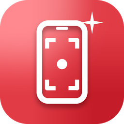
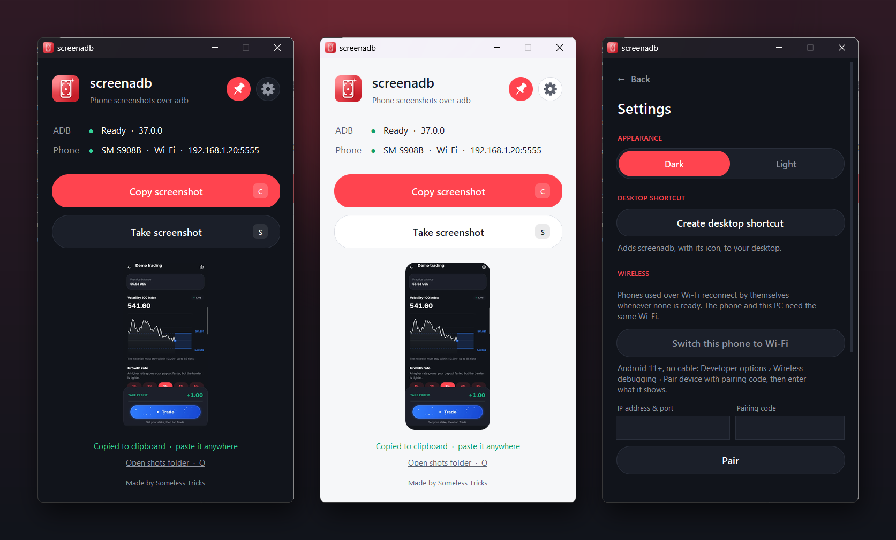
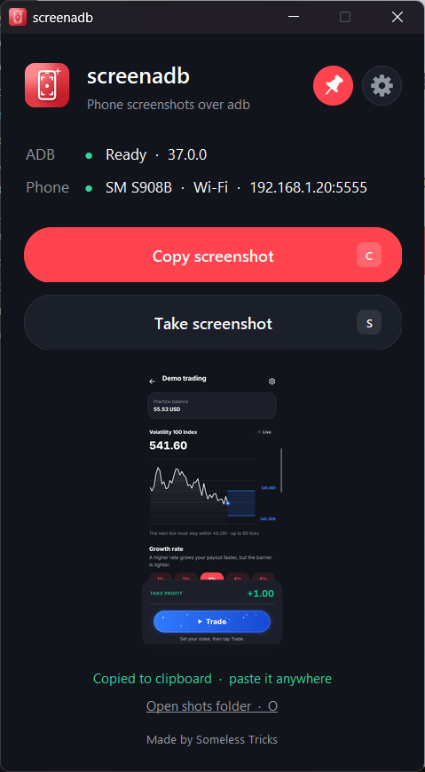
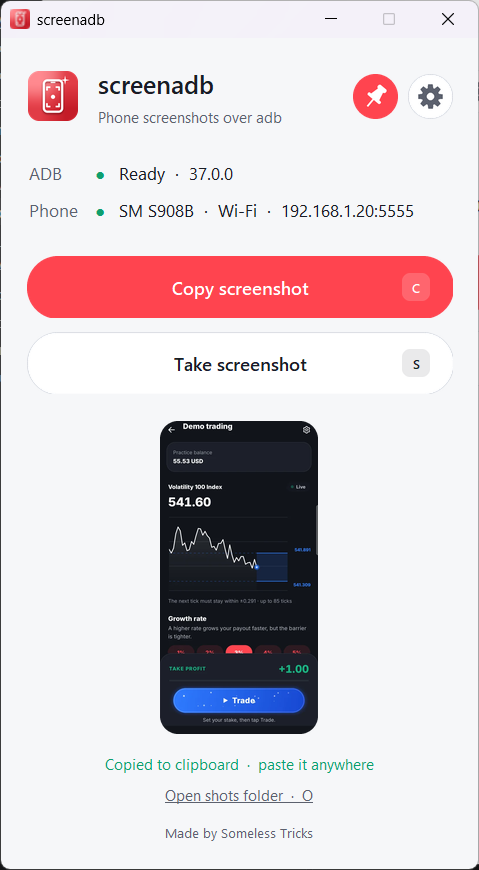
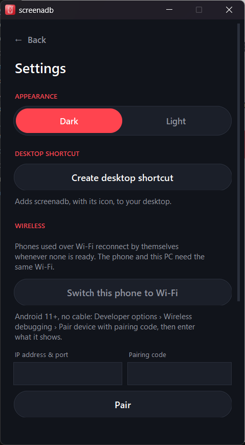
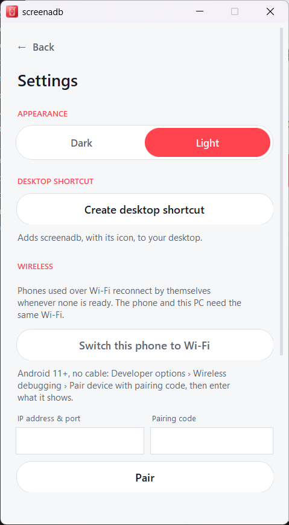

<p align="center">
  
</p>

<h1 align="center">screenadb</h1>

<p align="center">
  <b>Your Android phone's screen, on your PC's clipboard, in one key press.</b><br>
  A tiny Windows app that grabs phone screenshots over adb, by USB cable or over Wi-Fi.
</p>

<p align="center">
  
  
  
  
  
</p>

<p align="center">
  <a href="https://github.com/boyoftime/screenadb/releases/latest/download/screenadb-1.2-windows.zip"></a>
</p>

<p align="center">
  
</p>

---

## Why

Building an Android app, writing docs or reporting a bug, you want what's on the phone in your chat, issue or design
tool **now**. Not after emailing it to yourself, not after hunting for it in a gallery.

Press **C** and the phone's screen is on your clipboard, ready to paste. Press **S** and it's saved as a PNG.

## Features

- **Copy or save in one key.** `C` copies to the clipboard, `S` saves a PNG into the `shots` folder.
- **Near-instant shots.** While your pointer is over the window, screenadb keeps a fresh shot ready in the
  background, so a click lands at once. Otherwise a shot takes about half a second.
- **USB or Wi-Fi.** Use a cable, switch a plugged-in phone to Wi-Fi with one click, or pair with a code on Android 11+.
- **Reconnects by itself.** A phone you've used over Wi-Fi comes back on its own whenever no phone is ready, even
  after its wireless debugging port changes.
- **Several phones.** Click the phone line to switch between connected phones.
- **No adb? No problem.** screenadb offers to download Google's official platform-tools (about 8 MB) into its own
  folder.
- **Dark and light themes**, sharp on high-DPI screens, and a **keep on top** pin for working alongside your editor.
- **Nothing to install.** Download the zip, unzip it, run `screenadb.exe`. Python is built in.

## Screenshots

| Dark | Light |
| :---: | :---: |
|  |  |
|  |  |

## Install

You need **Windows 10 or 11**. There's no Python or anything else to install: it's all inside.

1. Download **[screenadb-1.2-windows.zip](https://github.com/boyoftime/screenadb/releases/latest/download/screenadb-1.2-windows.zip)**
   from the [latest release](https://github.com/boyoftime/screenadb/releases/latest).
2. Unzip it anywhere, for example into `Documents`.
3. Open the `screenadb` folder and run **`screenadb.exe`**.

Then open **Settings › Create desktop shortcut** to launch it from the desktop with its own icon.

Keep the folder together: `screenadb.exe` needs the `_internal` folder beside it. Your shots and settings are saved
in the same folder.

> **Windows SmartScreen** may warn the first time, because the exe isn't code-signed. Click **More info › Run
> anyway**.

> If adb isn't installed, screenadb says so and offers **Install adb**. It uses an adb already on your `PATH` or in
> the Android SDK if it finds one.

### Run from source (for developers)

With **Python 3.8+**:

```powershell
git clone https://github.com/boyoftime/screenadb.git
cd screenadb
py -m pip install -r requirements.txt
pyw screenadb.pyw
```

To build the zip yourself: `py -m pip install pyinstaller`, then `py build_exe.py`. It writes
`dist/screenadb-<version>-windows.zip`.

## Connect your phone

### With a USB cable

1. On the phone: **Settings › About phone**, then tap **Build number** 7 times to turn on Developer options.
2. **Settings › Developer options**, then turn on **USB debugging**.
3. Plug the phone in with a cable that carries data, then tap **Allow** on the phone. Tick *Always allow* to skip
   this next time.

### Over Wi-Fi

The phone and the PC need to be on the same Wi-Fi.

- **From USB, one click:** with the phone plugged in, open **Settings › Wireless › Switch this phone to Wi-Fi**, then
  unplug it. After the phone restarts, plug it in once more and switch it again.
- **No cable, Android 11+:** on the phone, open **Developer options › Wireless debugging › Pair device with pairing
  code**. In screenadb, open **Settings › Wireless**, enter the *IP address & port* and the *pairing code* it shows,
  then press **Pair**. You only pair once. From then on the phone connects by itself whenever Wireless debugging is
  on.

## Keys

| Key | What it does |
| :-: | --- |
| `C` | Copy a screenshot to the clipboard |
| `S` | Save a screenshot into `shots/` |
| `O` | Open the `shots` folder |
| `P` | Keep the window on top (or stop) |
| `Esc` | Leave Settings |

Clicking the preview opens the last shot.

## How it's fast

A screenshot normally travels as a PNG that the phone has to compress, which is slow. screenadb asks the phone for
raw pixels squeezed with `gzip -1`, and reads them straight from the adb server's socket instead of starting a new
`adb.exe` for every shot. On a Galaxy S22 that's about **0.3 s per shot**, against 0.45 s for PNG and 1 s for
unpacked pixels. Phones without `gzip` fall back to PNG automatically.

## Files

| File | What it is |
| --- | --- |
| `screenadb.pyw` | The whole app |
| `screenadb.png`, `screenadb.ico` | The icon for the window, shortcut and taskbar |
| `make_icon.py` | Draws the icon; run it again after changing the design |
| `build_exe.py` | Builds the Windows zip with Python built in |
| `docs/` | The screenshots in this README |

On first run, screenadb also creates `settings.json` (theme, pin, window position, Wi-Fi phones), `shots/` and,
if you let it install adb, `platform-tools/`. They're kept out of git by `.gitignore`.

## Troubleshooting

- **"No phone found."** Check that USB debugging is on and the cable carries data. Some cables only charge. Over
  Wi-Fi, check that Wireless debugging is on and both devices share the network.
- **"Waiting for you to allow it."** Unlock the phone and tap **Allow** on the USB debugging prompt.
- **Pairing fails.** The code changes every time the pairing dialog opens. Use the address and code that are on
  screen right now.
- **A switched-to-Wi-Fi phone stopped connecting.** Restarting the phone turns that mode off. Plug it in and press
  **Switch this phone to Wi-Fi** again, or pair it with a code, which survives restarts.

## License

[MIT](LICENSE): free to use, change and share, in personal or commercial projects.

---

<p align="center">
  <br>
  Made by <b>Someless Tricks</b>
</p>
